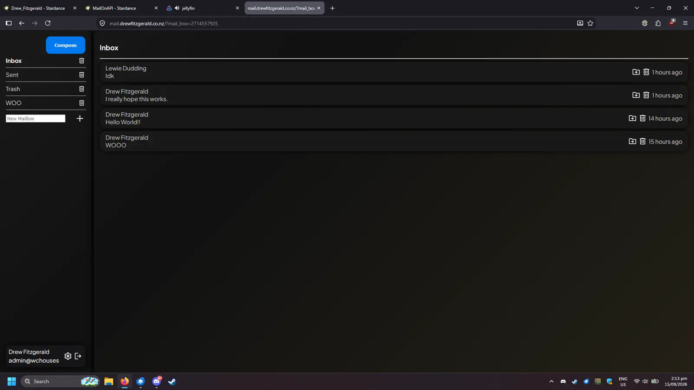

## Mail On A PI
MailOnAPI or Mail On a PI is a self hosted email server and client. It acts as a frontend for various popular mail services and is designed to run on a raspberry PI.  
It was originally called Mail On a PI but has moreso taken the name MailOnAPI.



### Features
Mail Recieving  
Mail Sending  
Mail Storage  
Internet Mail Access Protocal 4REV1  
Mail Boxes

### Running locally
Running localally requires having a MYSQL server somewhere on the local network running and a config file.  
The config file should be called config.json and be in the root directory.    
Example Config
```json
{
    "email": {
        "type": "resend",
        "auth": ""
    },
    "database": {
        "mysql_host": "",
        "mysql_port": ,
        "mysql_user": "",
        "mysql_password": "",
        "mysql_db": ""
    },
    "imapGreetings": [
        "Oh great, another human looking for unread emails",
        "IMAP Server V4 ready. Insert coin to continue",
        "Welcome to CompuServe 2.0 (just kidding, it's just us)"
    ],
    "port": 8080,
    "imap_port": 143,
    "imaps_port": 993,
    "tls": {
        "private_key": "",
        "cert": ""
    },
    "salt_rounds": 12,
    "attachment_path": "/attachments",
    "encodings": {
        "7bit": ["utf-7", "us-ascii"]
    }
}
```

Running the mail server.
``` sh
npm install
npm run start
```